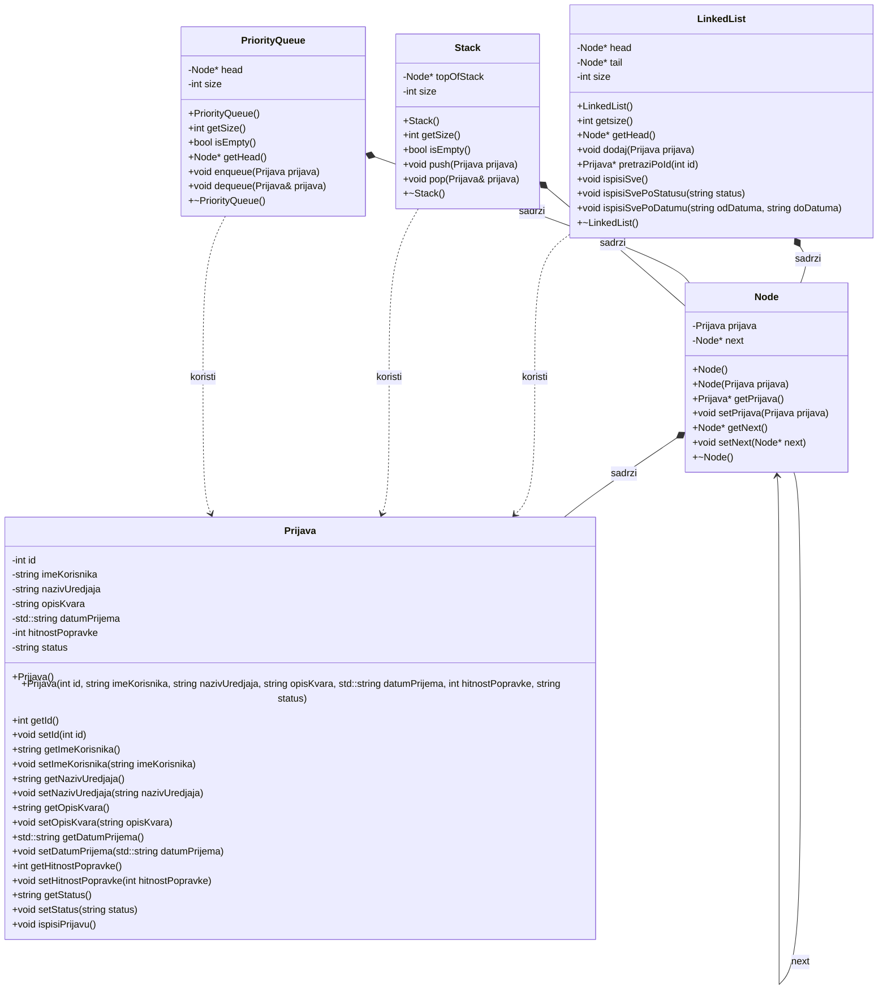

# Konzolna aplikacija za vođenje evidencije prijava kvarova u servisnom centru

### Cilj

U programskom jeziku C ili C++ implementirati konzolnu aplikaciju za vođenje evidencije prijava kvarova u servisnom centru.

### Zahtjevi

Svaka prijava sadrži jedinstveni identifikator, ime korisnika, naziv uređaja, kratak opis kvara, datum prijema, hitnost popravke na skali od 1 do 10 i status koji može imati vrijednost “na čekanju” i “završena”. Identifikatori se dodjeljuju automatski i rastu redoslijedom prijema. Moguće je evidentirati više prijava za isti datum.
Pri pokretanju programa učitati postojeće prijave iz evidencije u obliku tekstualne datoteke prijave.txt i smjestiti ih u ulančanu listu. Omogućiti sljedeće operacije:
1. Dodavanje prijave - Korisnik unosi podatke, a nova prijava automatski dobija status “na čekanju” i dodaje se u evidenciju.
2. Obrada naredne prijave - Prilikom obrade prednost imaju obrade veće hitnosti a pri jednakoj hitnosti obrađuje se prijava koja je primljena ranije. Obradom se prijava prijava uklanja iz prioritetnog reda i njen status se mijenja u “završena”, a obrađena prijava ostaje sačuvana u evidenciji.
3. Poništavanje obrade - Korištenjem steka omogućiti vraćanje posljednje obrađene prijave u status “na čekanju”. Prijavu ponovo umetnuti u prioritetni red prema njenoj hitnosti i izvornom redoslijedu prijema. Poništavanje se može ponavljati dok postoje obrade završene u tekućem pokretanju programa. Stek je prazan pri svakom pokretanju programa.
4. Pregled i pretraga - Omogućiti prikaz svih prijava, pronalaženje prijave prema identifikatoru i prikaz samo prijava određenog statusa.
5. Filtriranje prema datumima - Za zadati opseg datuma, uključujući granične datume, prikazati odgovarajuće prijave sortirane rastuće prema datumu, a zatim prema identifikatoru.
Prilikom izlaska iz programa sačuvati trenutnu evidenciju u datoteku. Sve korake izvršavanja programa ispisivati na konzolu. U slučaju graničnih slučajeva prilikom pristupa strukturama podataka ispisati odgovarajuću poruku na konzolu.

### Realizacija

# Izvještaj

U okviru ovog projekta implementirana je konzolna aplikacija u programskom jeziku C++ koja simulira prijem i obradu prijava kvarova u servisnom centru. Sistem omogućava vođenje kompletne evidencije kvarova, automatsko dodjeljivanje identifikatora, raspoređivanje zahtjeva prema stepenu hitnosti, obradu po prioritetu, istorijat obrada sa mogućnošću poništavanja (Undo), kao i pretragu i filtriranje prijava prema datumu. Aplikacija je razvijena sa fokusom na samostalnu implementaciju osnovnih struktura podataka (jednostruko ulančana lista, prioritetni red i stek). U skladu sa zahtjevima zadatka, nisu korištene gotove strukture iz Standardne biblioteke, već su sve strukture isprogramirane od nule kroz dinamičko upravljanje memorijom, pokazivače i principe objektno-orijentisanog programiranja uz poštovanje separacije odgovornosti.

### Strukture podataka

Projekat je podijeljen u nekoliko logičkih cjelina (modula) radi poštovanja principa enkapsulacije i jedinstvene odgovornosti:

* **Prijava:** Klasa koja modeluje sam kvar sa svim potrebnim podacima (ID, ime korisnika, naziv uređaja, opis kvara, datum prijema, hitnost i status).
* **Node:** Čvor jednostruko ulančanih struktura koji sadrži objekat prijave i pokazivač na sljedeći čvor.
* **LinkedList:** Predstavlja bazu podataka u memoriji i čuva kompletnu evidenciju servisa. Posjeduje pokazivače na glavu (`head`) i rep (`tail`), što omogućava dodavanje novih prijava na kraj liste u $O(1)$ složenosti bez prolaska kroz listu.
* **PriorityQueue:** Prioritetni red koji sadrži samo prijave koje su na čekanju. Prilikom umetanja prijave se automatski slažu po hitnosti (od 10 prema 1), dok se pri istoj hitnosti poštuje redoslijed prijema (ranije pristigla prijava ima prednost, a kako se ID dodjeljuje automatski, to je bas ona prijava koja ima manji ID).
* **Stack:** Struktura sa LIFO pristupom koja služi kao istorija obrada unutar trenutne sesije programa, odnosno u trenutnom izvrsenju programa. Koristi se za realizaciju povratka (Undo) posljednje obrađene prijave nazad u red čekanja, gdje se ona dodaje po kriterijumima po kojima je i prvi put bila dodana.
* **fileIO:** Odvojen modul sa funkcijama za učitavanje podataka iz datoteke `prijave.txt` na početku i trajno snimanje ažurirane liste na disku, u istoj datoteci, prilikom zatvaranja programa.

### Analiza vremenske složenosti i moguće optimizacije

* **Dodavanje prijave:** Upis u glavnu listu (evidenciju) ima složenost $O(1)$, zbog atributa `tail`, koji je pokazivač na kraj liste, a umetanje u prioritetni red $O(N)$ jer se prolaskom kroz red traži odgovarajuće mjesto po hitnosti. Pošto imamo fiksan i mali broj prioriteta (samo cijeli brojevi od 1 do 10), red je moguće dodatno optimiyovati primjenom tzv. *Bucket Queue* strukture. To znači da bi red enkapsulirao niz od 10 pokazivača, pri čemu je niz[i] pokazivač na kraj (posljednji element) sekcije liste koja sadrži prijave prioriteta i+1, i važi $i \in {0,1, ..., 9}$. Utom slučaju umetanje nove prijave bilo bi **$O(1)$**, jer bi se prijava na osnovu prioriteta direktno kačila na kraj odgovarajućeg dijela (čime bi automatski bio ispoštovan i redoslijed dolaska). Tada bi vađenje najhitnije prijave zahtijevalo najviše 10 provjera u nizu, što predstavlja fiksno vrijeme, odnosno  složenost **$O(1)$**. 
* **Obrada naredne prijave:** Uklanjanje sa početka prioritetnog reda je $O(1)$, stavljanje na vrh steka $O(1)$, dok je pronalaženje i izmjena statusa u evidenciji $O(N)$.
* **Poništavanje obrade (Undo):** Skidanje sa steka je $O(1)$, a ponovno vraćanje u red $O(N)$.
* **Pretraga po ID-ju:** Složenost za ovu opciju je $O(N)$, uz prekid petlje čim se naiđe na veći identifikator, dakle, neće se bespotrebno iterirati kroz cijelu listu.
* **Filtriranje po opsegu datuma:** Izdvajanje prijava koje su primljene u servis u zadatom opsegu datuma u pomoćni niz pokazivača traje $O(N)$, a sortiranje tog podskupa pomoću Selection Sort algoritma iznosi $O(K^2)$, gdje je $K$ broj pronađenih prijava u tom intervalu. Odnosno, u memoriji se rezerviše niz kapaciteta koji odgovara najgorem slučaju, ali se sortira samo frakcija niza koja se popuni pri izdvajanju odgovarajućih prijava.

### Rezultati testiranja

Aplikacija je testirana kroz simulaciju svih funkcionalnosti na dva nezavisna primjera:
1. Zvanični skup podataka sa Moodle stranice (`prijave.txt` sa 20 unosa).
2. Sopstveni testni fajl sa 5 unosa (`moje_prijave.txt`).

U oba slučaja potvrđeno je ispravno rukovanje graničnim slučajevima (poziv poništavanja kada je stek prazan, pretraga nepostojećeg identifikatora i opseg datuma bez rezultata).

 

<b>Jana Antelj, 1178/25</b>

