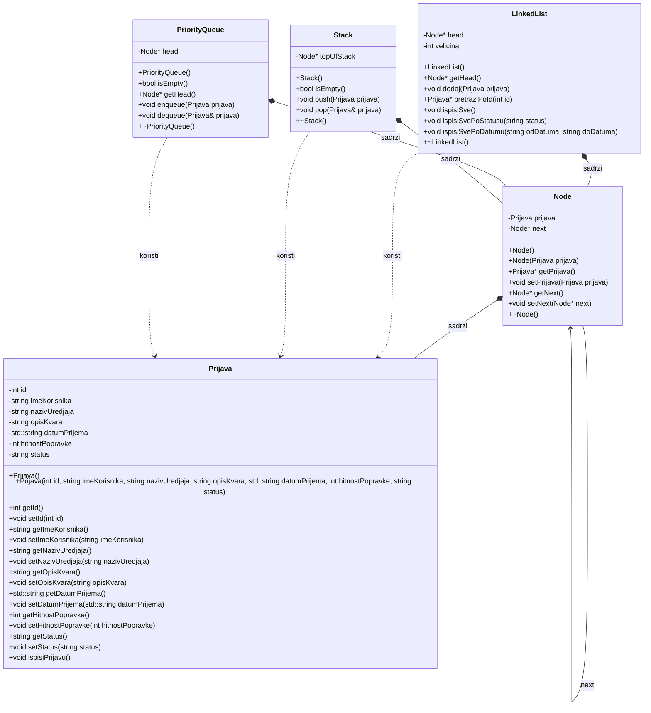

# Konzolna aplikacija za vođenje evidencije prijava kvarova u servisnom centru

### Cilj

U programskom jeziku C ili C++ implementirati konzolnu aplikaciju za vođenje evidencije prijava kvarova u servisnom centru.

### Zahtjevi

Svaka prijava sadrži jedinstveni identifikator, ime korisnika, naziv uređaja, kratak opis kvara, datum prijema, hitnost popravke na skali od 1 do 10 i status koji može imati vrijednost “na čekanju” i “završena”. Identifikatori se dodjeljuju automatski i rastu redoslijedom prijema. Moguće je evidentirati više prijava za isti datum.
Pri pokretanju programa učitati postojeće prijave iz evidencije u obliku tekstualne datoteke prijave.txt i smjestiti ih u ulančanu listu. Omogućiti sljedeće operacije:
1. Dodavanje prijave - Korisnik unosi podatke, a nova prijava automatski dobija status “na čekanju” i dodaje se u evidenciju.
2. Obrada naredne prijave - Prilikom obrade prednost imaju obrade veće hitnosti a pri jednakoj hitnosti obrađuje se prijava koja je primljena ranije. Obradom se prijava prijava uklanja iz prioritetnog reda i njen status se mijenja u “završena”, a obrađena prijava ostaje sačuvana u evidenciji.
3. Poništavanje obrade - Korištenjem steka omogućiti vraćanje posljednje obrađene prijave u status “na čekanju”. Prijavu ponovo umetnuti u prioritetni red prema njenoj hitnosti i izvornom redoslijedu prijema. Poništavanje se može ponavljati dok postoje obrade završene u tekućem pokretanju programa. Stek je prazan pri svakom pokretanju programa.
4. Pregled i pretraga - Omogućiti prikaz svih prijava, pronalaženje prijave prema identifikatoru i prikaz samo prijava određenog statusa.
5. Filtriranje prema datumima - Za zadati opseg datuma, uključujući granične datume, prikazati odgovarajuće prijave sortirane rastuće prema datumu, a zatim prema identifikatoru.
Prilikom izlaska iz programa sačuvati trenutnu evidenciju u datoteku. Sve korake izvršavanja programa ispisivati na konzolu. U slučaju graničnih slučajeva prilikom pristupa strukturama podataka ispisati odgovarajuću poruku na konzolu.

### Realizacija

### Izvjestaj
